# TypeXAI: Toward Explainable Keystroke Intelligence

[](https://www.python.org/)
[](LICENSE)
[](https://xgboost.readthedocs.io/)
[](https://shap.readthedocs.io/)
[](https://www.linkedin.com/in/gokul-ram-k-277a6a308/)

# An Explainable Machine Learning Approach to Keystroke-Based User Identification

[](https://ieee.org)
[](https://python.org)
[](LICENSE)

> **Accepted at the 2026 5th International Conference on Automation, Computing and Renewable Systems (ICACRS) — IEEE.**

---

## 👨‍💻 Lead Researcher & Author

**Gokul Ram K**  
*School of Computer Science and Engineering, Vellore Institute of Technology, Chennai, India*  
📧 **Email**: [gokul.ram.kannan210905@gmail.com](mailto:gokul.ram.kannan210905@gmail.com)  
🔗 **LinkedIn**: [gokul-ram-k-277a6a308](https://www.linkedin.com/in/gokul-ram-k-277a6a308/)  

---

## 📌 Abstract & Overview

Human typing patterns encode a unique **cognitive-motor signature** suitable for continuous, non-invasive biometric user identification. However, existing keystroke authentication models operate primarily as black boxes, providing limited transparency and stakeholder trust. 

**TypeXAI** introduces an explainable machine learning framework featuring:
1. **High-Precision Classification Core**: Hyperparameter-tuned **XGBoost** tree ensembles.
2. **Multi-Level XAI Pipeline**: SHAP-based global feature rankings, local instance attributions, and feature interaction maps.
3. **Cognitive Manifold Projections**: Low-dimensional 2D **t-SNE** embeddings revealing clear inter-user behavioral clustering.

Evaluating on the benchmark **CMU Keystroke Dynamics Dataset** (51 typists, 20,400 records), TypeXAI achieves an average accuracy of **94.54% ± 0.0039** under 5-fold cross-validation, outperforming Multilayer Perceptron (MLP) and Random Forest baselines while delivering audit-ready explainability.

---

## 🏗️ Framework Architecture

```text
               +-------------------------------------------+
               |     Raw Keystroke Timing Input            |
               |  (Hold, Down-Down, Up-Down Latencies)     |
               +---------------------+---------------------+
                                     |
                                     v
               +---------------------+---------------------+
               |   Preprocessing & Feature Scaling         |
               |  (IQR Filtering, StandardScaler)          |
               +---------------------+---------------------+
                                     |
                                     v
               +---------------------+---------------------+
               |    XGBoost Discriminative Engine          |
               |    (200 Trees, 51-Class Multi-Logloss)    |
               +---------------------+---------------------+
                                     |
           +-------------------------+-------------------------+
           |                                                   |
           v                                                   v
+----------+------------------+             +------------------+----------+
|   Multi-Level XAI Engine    |             |  Manifold Visualization     |
| (SHAP Global/Local/Waterfall|             | (t-SNE 2D Cognitive     |
|    Interaction Maps)        |             |    Embeddings)              |
+-----------------------------+             +-----------------------------+
```

---

## 📊 Experimental Results

### Model Comparison
| Model | Accuracy | Weighted Precision | Weighted Recall | Weighted F1-Score |
| :--- | :---: | :---: | :---: | :---: |
| 🥇 **XGBoost (TypeXAI Core)** | **94.93%** | **95.04%** | **94.93%** | **94.92%** |
| 🥈 Random Forest | 94.02% | 94.16% | 94.02% | 93.98% |
| 🥉 Multilayer Perceptron (MLP) | 92.08% | 92.24% | 92.08% | 92.05% |

### 5-Fold Stratified Cross-Validation Summary
| Metric | Fold 1 | Fold 2 | Fold 3 | Fold 4 | Fold 5 | Mean ± Std |
| :--- | :---: | :---: | :---: | :---: | :---: | :---: |
| **Accuracy** | 0.9493 | 0.9412 | 0.9466 | 0.9414 | 0.9485 | **0.9454 ± 0.0039** |
| **Precision** | 0.9504 | 0.9421 | 0.9472 | 0.9423 | 0.9493 | **0.9463 ± 0.0038** |
| **Recall** | 0.9493 | 0.9412 | 0.9466 | 0.9414 | 0.9485 | **0.9454 ± 0.0039** |
| **F1-Score** | 0.9492 | 0.9413 | 0.9468 | 0.9415 | 0.9487 | **0.9455 ± 0.0039** |

---

## 📈 Visual Performance & Explainability Assets

### 1. Classification Performance
| Model Performance Comparison | 5-Fold CV Accuracy |
| :---: | :---: |
| 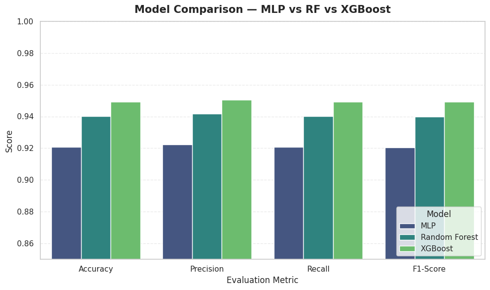 | 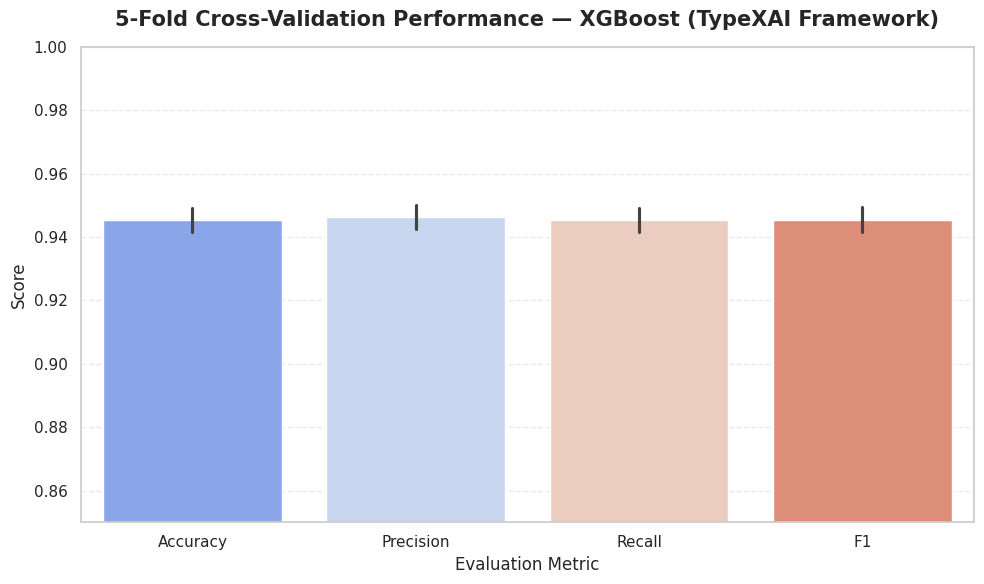 |

| Inter-Fold Variability Boxplot | Normalized Confusion Matrix (Top 10 Classes) |
| :---: | :---: |
| 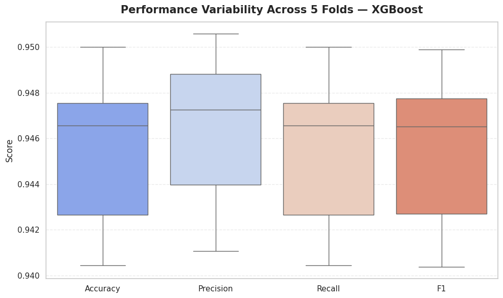 | 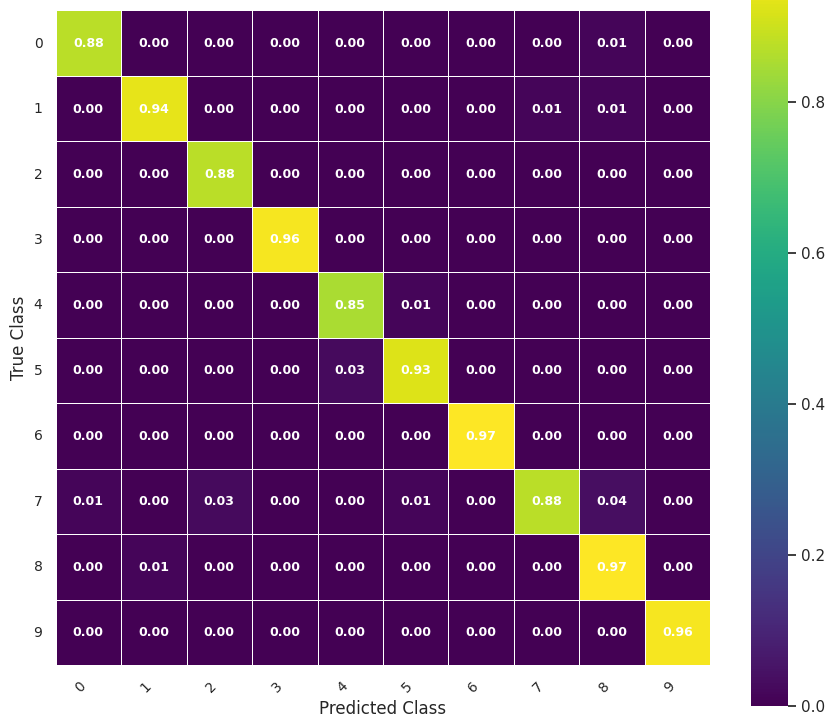 |

| Multi-Class ROC-AUC Curves | Feature Correlation Heatmap |
| :---: | :---: |
| 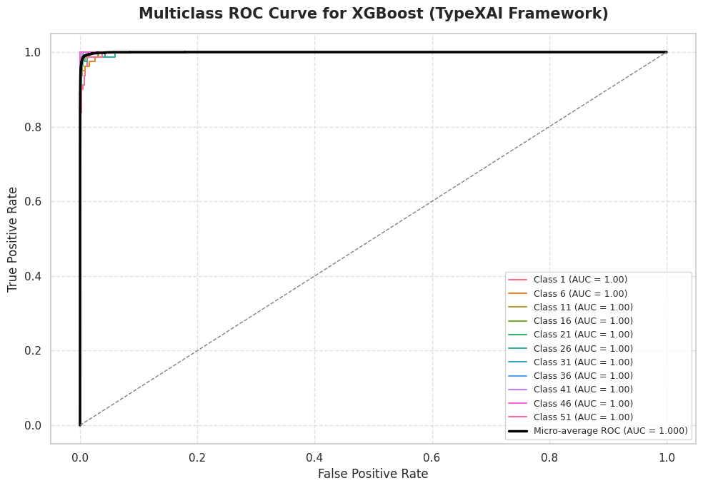 | 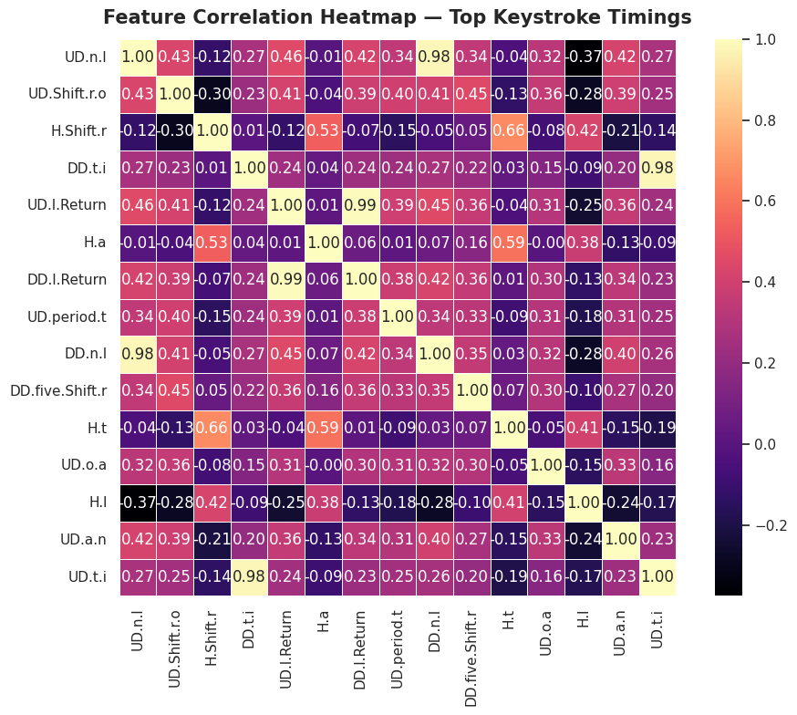 |

---

### 2. Multi-Level XAI & Manifold Visualizations
| Top 15 Feature Importances | Global SHAP Spectrum |
| :---: | :---: |
| 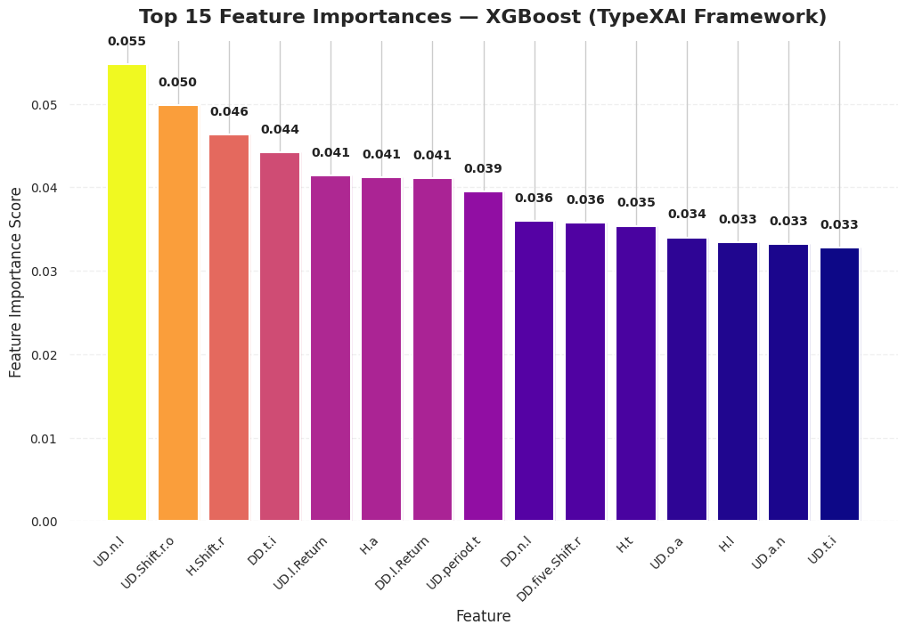 | 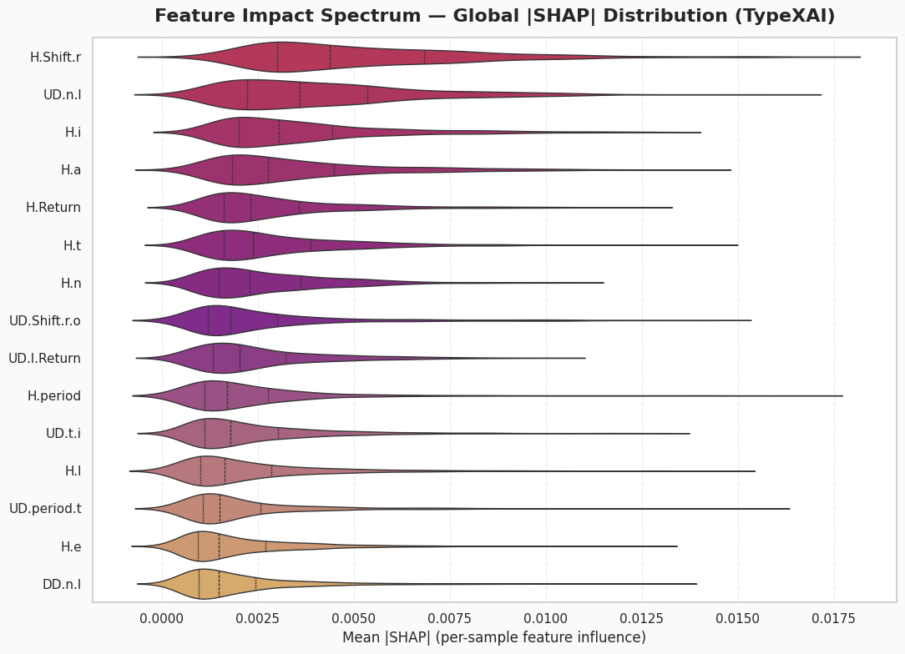 |

| SHAP Summary Distribution | Local SHAP Waterfall Plot (Class 0) |
| :---: | :---: |
| 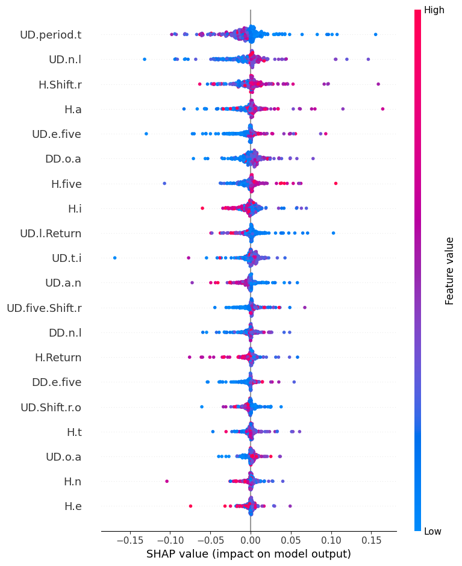 | 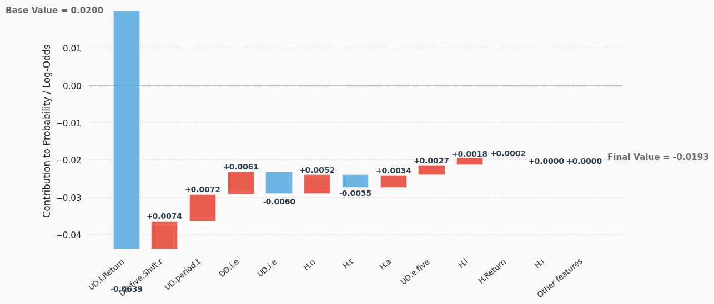 |

| SHAP Interaction Map | t-SNE 2D Cognitive Embeddings |
| :---: | :---: |
| 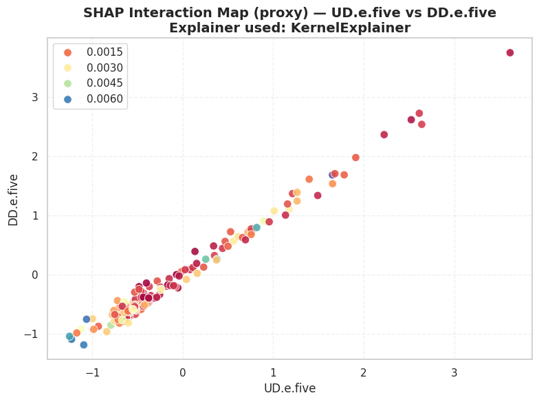 | 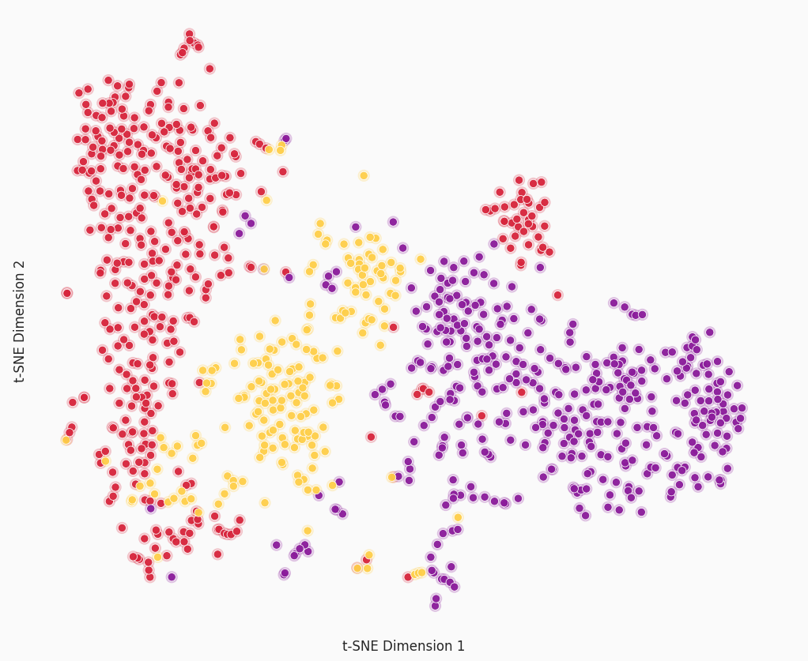 |

---

## 📁 Repository Structure

```text
Keystroke-XAI/
├── README.md                           # Comprehensive project documentation
├── LICENSE                             # MIT License
├── .gitignore                          # Git ignore rules
├── requirements.txt                    # Python environment dependencies
├── docs/
│   └── paper_summary.md                # Academic paper summary & methodology
├── notebooks/
│   └── keystroke_intelligence_xai.ipynb  # End-to-end reproducible Jupyter Notebook
├── assets/                             # Standardized high-res visualization plots
│   ├── xgboost_5fold_cross_validation.png
│   ├── feature_correlation_heatmap.png
│   ├── global_shap_feature_spectrum.png
│   ├── model_performance_comparison.png
│   ├── xgboost_multiclass_roc_curve.png
│   ├── confusion_matrix_top10_classes.png
│   ├── fold_variability_analysis.png
│   ├── shap_interaction_map.png
│   ├── shap_waterfall_prediction_class0.png
│   ├── shap_summary_impact_distribution.png
│   ├── tsne_cognitive_embeddings.png
│   └── xgboost_top15_feature_importance.png
└── src/                                # Modular Python package
    ├── __init__.py
    ├── data_loader.py                  # Preprocessing & StandardScaler pipeline
    ├── model_trainer.py                # Classifier training & 5-Fold Stratified CV
    ├── evaluate.py                     # Performance metrics, CM, and ROC utilities
    └── explainability.py               # SHAP feature attributions & t-SNE projections
```

---

## 🚀 Getting Started

### 1. Clone Repository & Navigate
```bash
git clone https://github.com
cd Keystroke-XAI
```

### 2. Environment Setup
Create a virtual environment and install dependencies:
```bash
python -m venv venv
# On Windows:
venv\Scripts\activate
# On Linux/macOS:
source venv/bin/activate

pip install -r requirements.txt
```

### 3. Running via Modular Source
```python
from src.data_loader import load_keystroke_dataset, preprocess_keystroke_data
from src.model_trainer import train_xgboost, run_5fold_cross_validation
from src.evaluate import compute_metrics

# 1. Load Data
df = load_keystroke_dataset("DSL-StrongPasswordData.csv")
data = preprocess_keystroke_data(df)

# 2. Train Production Model
model = train_xgboost(data['X_train'], data['y_train'])

# 3. Evaluate
preds = model.predict(data['X_test'])
metrics = compute_metrics(data['y_test'], preds)
print(f"XGBoost Test Accuracy: {metrics['Accuracy']:.4f}")
```

### 4. Running via Jupyter Notebook
Launch Jupyter Notebook to execute interactive cells:
```bash
jupyter notebook notebooks/keystroke_intelligence_xai.ipynb
```

---

## 📜 License

This project is licensed under the **MIT License** - see the [LICENSE](LICENSE) file for details.
